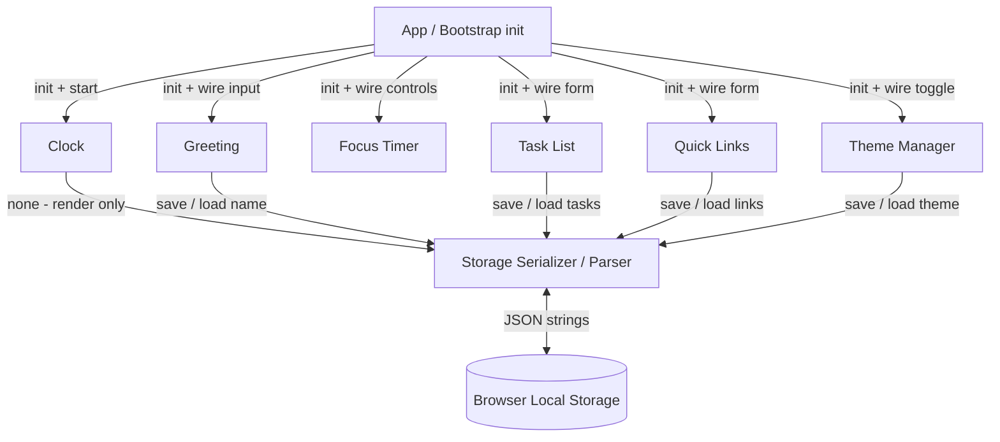
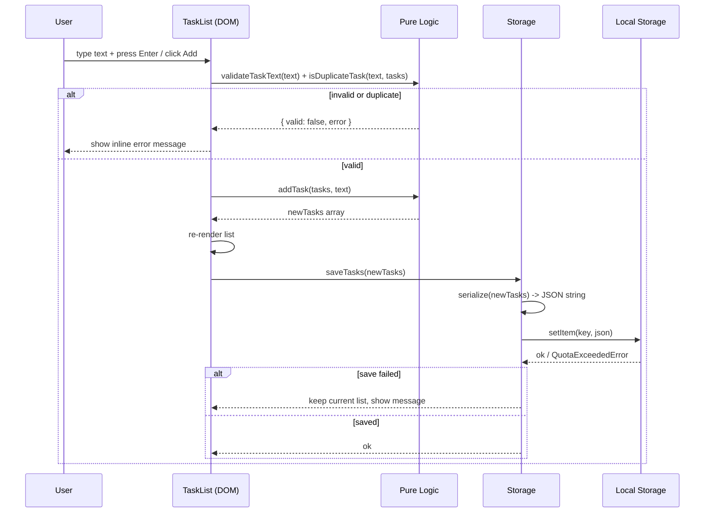

# Design Document

## Introduction

This document is the technical design for the **To-Do List Life Dashboard**, a single-page web application built with plain HTML, CSS, and vanilla JavaScript. It has no front-end framework and no backend server; all data is saved in the browser through the Local Storage API. The design implements every requirement in `requirements.md` and explains the decisions behind each part in beginner-friendly language.

The design is intentionally simple and explicit so that a developer who is still learning web development can read `js/script.js` and understand what each piece does. We avoid advanced patterns (no build tools, no module bundlers, no external libraries in the shipped app) and prefer a small set of clearly named functions organized under one namespace object.

### Design Goals

- **Simplicity**: One HTML file, one CSS file, one JavaScript file. Each feature is a self-contained group of functions.
- **Persistence**: All user data (display name, tasks, quick links, theme) survives a page reload via Local Storage, serialized as JSON.
- **Correctness**: Pure logic (formatting, validation, timer math, serialization) is separated from DOM code so it can be tested with property-based and unit tests.
- **Responsiveness**: A CSS Grid layout with media queries adapts the page from one to three columns across phone, tablet, and desktop widths.
- **Graceful failure**: Corrupt or missing Local Storage data never crashes the app; defaults are restored.

### Research and Key Findings

The technologies used here are stable, well-documented browser APIs. The key findings that shaped the design are:

- **Timer accuracy**: `setInterval` callbacks are not guaranteed to fire exactly on time and can drift, so the remaining time must be computed from real elapsed time using `Date.now()` timestamps captured at start and at each update (see the [Performance.now / Date.now guidance on MDN](https://developer.mozilla.org/en-US/docs/Web/JavaScript/Reference/Global_Objects/Date/now)). This directly satisfies Requirement 2.8.
- **Local Storage behavior**: `localStorage.setItem` can throw a `QuotaExceededError` when storage is full or unavailable (private browsing in some browsers). Reads of missing keys return `null`. All reads are wrapped in `try/catch` with a default value fallback, satisfying Requirements 5.5 and 7.4 (see [Web Storage API on MDN](https://developer.mozilla.org/en-US/docs/Web/API/Web_Storage_API/Using_the_Web_Storage_API)).
- **URL validation**: The `URL` constructor throws for invalid URLs and exposes a `protocol` property. A valid HTTP/HTTPS URL is one that constructs successfully and whose `protocol` is `http:` or `https:` (see [URL constructor on MDN](https://developer.mozilla.org/en-US/docs/Web/API/URL/URL)). This satisfies Requirement 4.9 without importing any library.
- **Responsive layout**: CSS Grid with `auto-fit`/`minmax` plus explicit media queries at 768px and 1024px cleanly satisfies the three breakpoints in Requirement 6 (see [CSS Grid Layout on MDN](https://developer.mozilla.org/en-US/docs/Web/CSS/CSS_grid_layout)).

No external packages are needed; the standard browser APIs are sufficient for every requirement.

## Overview

The Dashboard is a single page with five interactive features grouped into clearly bounded components:

1. **Clock** — shows the current time and date, updating once per second.
2. **Greeting** — shows a time-of-day greeting ("Good morning", etc.) and an editable display name.
3. **Focus Timer** — a 25-minute Pomodoro countdown with Start/Stop/Reset.
4. **Task List** — add, edit, toggle-complete, and delete to-do items with duplicate and empty-input protection.
5. **Quick Links** — add, open, and delete website shortcuts, capped at 20.

Two cross-cutting pieces support all five features:

- **Theme Manager** — toggles Light/Dark mode and persists the choice.
- **Storage** — a single module that serializes data to JSON, writes it to Local Storage, reads it back, parses it, and recovers gracefully from corrupt data.

An **App** bootstrap function wires every component to its DOM elements and starts the clock.

## Architecture

The application runs entirely in the browser. There is no server, no build step, and no framework. The code is organized as a set of functions attached to one global namespace object, `TDLD`, inside a single IIFE so that the global scope stays clean.

### High-Level Component Diagram



### Data Flow on a User Action

The diagram below shows what happens when a user adds a task. The same shape applies to every mutating action (toggle, delete, add quick link, set name, toggle theme):



### Layering Principles

- **Pure logic first**: functions that do math, formatting, validation, and duplicate checks take inputs and return outputs. They never touch the DOM and never read `localStorage` directly. This makes them testable.
- **DOM code calls logic, not the reverse**: the DOM-facing functions read input values, call pure logic, then update the page and ask `Storage` to persist the result.
- **One storage gateway**: every read/write to Local Storage goes through `TDLD.Storage`. No component calls `localStorage` directly, so serialization, parsing, and error recovery live in exactly one place.

## Components and Interfaces

All JavaScript lives in `js/script.js` and is grouped under the `TDLD` namespace. Function signatures below use plain JSDoc-style comments for clarity. "Pure" means the function has no DOM or storage side effects and is unit/property testable.

### Storage (Serializer / Parser) — `TDLD.Storage`

The single gateway to Local Storage. Every value is stored as a JSON string.

| Function | Signature | Purpose |
|---|---|---|
| `serialize` | `serialize(obj: Object) -> string` | Convert a data object/array/value to a valid JSON string. |
| `parse` | `parse(json: string, defaultValue: any) -> any` | Parse a JSON string; on any error or non-conforming result, return `defaultValue`. Never throws. |
| `load` | `load(key: string, defaultValue: any) -> any` | Read a key from Local Storage, `parse` it, and return the value or `defaultValue`. |
| `save` | `load(key: string, value: any) -> boolean` | `serialize` the value and write it; return `false` (without reverting) on `QuotaExceededError`. |

Storage key layout (all values JSON strings):

| Key | Stored value (JSON) | Default |
|---|---|---|
| `tdld.displayName` | `"<name>"` | `null` |
| `tdld.tasks` | `[{id,text,completed}, ...]` | `[]` |
| `tdld.quickLinks` | `[{id,label,url}, ...]` | `[]` |
| `tdld.theme` | `"<light"|"dark">` | `"light"` |

Pseudocode for the round-trip and recovery logic:

```text
serialize(obj):
    return JSON.stringify(obj)

parse(json, defaultValue):
    try:
        value = JSON.parse(json)
        // conformance check: typeof / Array.isArray / expected fields
        return conforms(value) ? value : defaultValue
    catch any error:
        return defaultValue

save(key, value):
    try:
        localStorage.setItem(key, serialize(value))
        return true
    catch (QuotaExceededError or SecurityError):
        return false   // caller keeps current displayed state

load(key, defaultValue):
    raw = localStorage.getItem(key)   // null if missing
    if raw is null: return defaultValue
    return parse(raw, defaultValue)
```

### Clock — `TDLD.Clock`

| Function | Signature | Purpose |
|---|---|---|
| `formatClock` | `formatClock(date: Date) -> string` (pure) | Return 24-hour `HH:MM:SS` with zero padding. |
| `formatDate` | `formatDate(date: Date) -> string` (pure) | Return a string containing day, month, and year (e.g., `"Monday, 5 January 2026"`). |
| `start` | `start(elements)` | Set up a `setInterval` that updates the time/date text once per second. |

The interval calls `formatClock(new Date())` and writes it to the time element. The cadence (once per second) is a UI concern; the correctness of the *format* is what is property-tested.

### Greeting — `TDLD.Greeting`

| Function | Signature | Purpose |
|---|---|---|
| `getGreetingText` | `getGreetingText(hour: number) -> string` (pure) | Map hour 0-23 to one of the four greeting strings using the ranges in Requirements 1.3-1.6. |
| `composeGreeting` | `composeGreeting(text: string, name: ?string) -> string` (pure) | Return `text` alone when `name` is null/empty, else `text + " " + name`. |
| `validateDisplayName` | `validateDisplayName(name: string) -> {valid: boolean, error?: string}` (pure) | Valid iff trimmed length is 1-50; otherwise return an error reason. |
| `render` | `render(elements, state)` | Compute the current greeting from the current hour and the stored name and write it to the page. |
| `setDisplayName` | `setDisplayName(elements, state, name)` | Validate, and if valid, store the name via `Storage.save`, update `state`, and re-render; if invalid, show the inline error and do not save. |

Boundary rules for `getGreetingText` (hour is the 24-hour local hour):

```text
hour in [5, 11]   -> "Good morning"
hour in [12, 16]  -> "Good afternoon"
hour in [17, 20]  -> "Good evening"
hour in [21, 23] or [0, 4] -> "Good night"
```

A single editable text input plus a submit action serves both entering a new name and changing an existing one (Requirement 1.12). Submitting a valid name replaces the previously saved name in storage and in the displayed greeting; no separate edit flow exists.

### Focus Timer — `TDLD.FocusTimer`

| Function | Signature | Purpose |
|---|---|---|
| `computeRemaining` | `computeRemaining(totalSeconds: number, startMs: number, nowMs: number) -> number` (pure) | Return `max(0, totalSeconds - floor((nowMs - startMs) / 1000))`. |
| `formatTimer` | `formatTimer(seconds: number) -> string` (pure) | Return `MM:SS` with zero padding, for `seconds` in `[0, 1500]`. |
| `canStart` | `canStart(state) -> boolean` (pure) | True iff `!state.running && state.remaining > 0`. |
| `start` | `start(elements, state)` | If `canStart`, record `startMs = Date.now() - (totalSeconds - remaining) * 1000` (so a paused timer resumes correctly) and begin an interval. |
| `stop` | `stop(elements, state)` | Clear the interval; keep `state.remaining` as-is. |
| `reset` | `reset(elements, state)` | Clear the interval; set `state.remaining = 1500`. |

**Timestamp-based accuracy algorithm (Requirement 2.8).** Instead of subtracting one from `remaining` on each `setInterval` tick, the timer stores the wall-clock time that corresponds to "remaining = 0" and recomputes the remaining seconds from real elapsed time on every update:

```text
on Start (fresh):  startMs = Date.now()
on Start (resume): startMs = Date.now() - (totalSeconds - remaining) * 1000
on each interval tick:
    elapsedSeconds = floor((Date.now() - startMs) / 1000)
    remaining = max(0, totalSeconds - elapsedSeconds)
    display formatTimer(remaining)
    if remaining <= 0:
        clear interval; running = false
```

Because `remaining` is always recomputed from `Date.now()` differences, setInterval drift cannot accumulate. The `max(0, ...)` clamp enforces the non-negative invariant (Requirement 2.7) and the `remaining <= 0` check stops the timer (Requirement 2.6). The default `totalSeconds` is `1500` (25 minutes), satisfying Requirement 2.1; reset restores this value (Requirement 2.5).

### Task List — `TDLD.TaskList`

| Function | Signature | Purpose |
|---|---|---|
| `validateTaskText` | `validateTaskText(text: string) -> {valid, error?}` (pure) | Valid iff trimmed length is 1-200. |
| `isDuplicateTask` | `isDuplicateTask(text: string, tasks: Task[]) -> boolean` (pure) | True iff any existing task's trimmed text equals `text.trim()` under case-sensitive comparison. |
| `addTask` | `addTask(tasks: Task[], text: string) -> {ok, tasks?, error?}` (pure) | Validate, then duplicate-check; on success append `{id, text: trimmed, completed: false}`. |
| `editTask` | `editTask(tasks: Task[], id, text: string) -> {ok, tasks?, error?}` (pure) | Validate, duplicate-check against *other* tasks; on success update text in place, preserving `completed` and position. On failure, tasks are returned unchanged. |
| `toggleTask` | `toggleTask(tasks: Task[], id) -> Task[]` (pure) | Flip `completed` for the matching id; preserve text and position. |
| `deleteTask` | `deleteTask(tasks: Task[], id) -> Task[]` (pure) | Remove the matching id; preserve order of the rest. |
| `saveTasks` | `saveTasks(tasks)` | `Storage.save('tdld.tasks', tasks)`. |
| `loadTasks` | `loadTasks() -> Task[]` | `Storage.load('tdld.tasks', [])`. |
| `render` | `render(elements, tasks)` | Build the list DOM, showing a checked indicator + strikethrough text for completed tasks and an unchecked indicator + plain text for uncompleted tasks. |

`id` is a simple unique identifier: `Date.now().toString(36) + Math.random().toString(36).slice(2, 7)`. It only needs to be unique within a session; persistence uses array order, not ids.

**No-duplicate-task invariant (Requirement 3.9).** Both `addTask` and `editTask` call `isDuplicateTask` before mutating the list. Because the only two ways text enters the list are these two functions, and both gate on the duplicate check, the invariant "no two tasks share identical trimmed text (case-sensitive)" is preserved across all submissions and edits. This is a single choke point, which makes the invariant easy to reason about and test.

### Quick Links — `TDLD.QuickLinks`

| Function | Signature | Purpose |
|---|---|---|
| `isValidHttpUrl` | `isValidHttpUrl(str: string) -> boolean` (pure) | `try { const u = new URL(str); return u.protocol === 'http:' || u.protocol === 'https:'; } catch { return false; }` |
| `validateQuickLink` | `validateQuickLink(label, url, listSize) -> {valid, error?}` (pure) | Valid iff label trimmed length 1-50, url trimmed length 1-2048, `isValidHttpUrl(url)`, and `listSize < 20`. |
| `addQuickLink` | `addQuickLink(links, label, url) -> {ok, links?, error?}` (pure) | Validate; on success append `{id, label: trimmed, url: trimmed}`. |
| `deleteQuickLink` | `deleteQuickLink(links, id) -> QuickLink[]` (pure) | Remove matching id; preserve order. |
| `openLink` | `openLink(url)` | `window.open(url, '_blank', 'noopener')`. |
| `saveQuickLinks` / `loadQuickLinks` | as above | Storage round-trip for `tdld.quickLinks`. |
| `render` | `render(elements, links)` | Build the link panel DOM. |

### Theme Manager — `TDLD.ThemeManager`

| Function | Signature | Purpose |
|---|---|---|
| `toggle` | `toggle(theme: "light"|"dark") -> "light"|"dark"` (pure) | Return the opposite theme. |
| `apply` | `apply(elements, theme)` | Set `data-theme` attribute / class on the root element; CSS variables do the rest. |
| `loadTheme` | `loadTheme() -> "light"|"dark"` (pure-ish) | `Storage.load('tdld.theme', 'light')`, normalized to `'light'` if the value is neither `'light'` nor `'dark'`. |
| `setTheme` | `setTheme(elements, state, theme)` | `apply`, then `Storage.save`; if save fails, keep the currently displayed theme (do not revert). |

Default Light rule (Requirement 5.4): `loadTheme` returns `'light'` for missing, `null`, or any non-`light`/`dark` stored value. Requirement 5.5 (keep current theme if save fails) is enforced by `setTheme` checking the boolean returned by `Storage.save` and never rolling back the applied theme.

### App / Bootstrap — `TDLD.App`

| Function | Signature | Purpose |
|---|---|---|
| `init` | `init()` | Query DOM elements, load persisted state, render all components, attach event listeners, start the clock interval. |

A DOM-guard ensures the script can also be loaded in a non-browser test environment:

```text
if (typeof document !== 'undefined' && document.readyState !== 'loading') {
    TDLD.App.init();
} else if (typeof document !== 'undefined') {
    document.addEventListener('DOMContentLoaded', () => TDLD.App.init());
}
```

## Data Models

All persisted values are stored as JSON strings. The in-memory shapes are plain JavaScript objects/arrays.

### Task

```text
Task = {
    id:        string,    // unique within a session
    text:      string,    // trimmed, length 1-200
    completed: boolean    // default false
}
```

### Quick_Link

```text
QuickLink = {
    id:    string,        // unique within a session
    label: string,        // trimmed, length 1-50
    url:   string         // trimmed, length 1-2048, valid http/https URL
}
```

### Stored Theme

```text
Theme = "light" | "dark"      // stored as a JSON string, e.g. '"light"'
```

### Stored Display Name

```text
DisplayName = string | null   // stored as a JSON string; null means "no name set"
```

### Application State (in memory, not persisted as a whole)

```text
State = {
    displayName: string | null,
    tasks:        Task[],
    quickLinks:   QuickLink[],
    theme:        "light" | "dark",
    timer: {
        totalSeconds: number,   // constant 1500
        remaining:    number,   // seconds, >= 0
        running:      boolean,
        startMs:      number | null  // wall-clock ms when countdown (effectively) began
    }
}
```

### Local Storage Key Layout

| Key | JSON value | Default when missing/corrupt |
|---|---|---|
| `tdld.displayName` | `"Alice"` or `null` | `null` |
| `tdld.tasks` | `[{"id":"a1","text":"...","completed":false}, ...]` | `[]` |
| `tdld.quickLinks` | `[{"id":"q1","label":"...","url":"..."}, ...]` | `[]` |
| `tdld.theme` | `"light"` or `"dark"` | `"light"` |

All keys share the `tdld.` prefix to avoid collisions with other apps on the same origin.

## Correctness Properties

*A property is a characteristic or behavior that should hold true across all valid executions of a system — essentially, a formal statement about what the system should do. Properties serve as the bridge between human-readable specifications and machine-verifiable correctness guarantees.*

The properties below are derived from the acceptance criteria. Each is a universal statement ("for all / for any") that can be checked with a property-based test over many generated inputs. A reflection pass consolidated overlapping criteria: the general serialization round-trip (Property 14) also covers the display-name and theme persistence instances (Requirements 1.8/1.9 and 5.2/5.3); the task/quick-link round-trips (Properties 11 and 13) are kept as distinct properties because they validate specific requirements and assert order/field equivalence for their domain shapes. Requirements 1.1's "valid JSON" (7.1) and 7.2 are subsumed by the serialization round-trip (Property 14). Requirements 6 (responsive layout) and 8 (technical constraints) are not property-testable and are handled with manual/visual and inspection checks described in Testing Strategy.

### Property 1: Clock formatting correctness

*For any* `Date` instant, `formatClock(date)` SHALL produce a 24-hour `HH:MM:SS` string with zero-padded two-digit hours, minutes, and seconds, and `formatDate(date)` SHALL produce a string containing the correct day, month, and year.

**Validates: Requirements 1.1, 1.2**

### Property 2: Greeting text matches the hour range

*For any* integer hour `h` in `0..23`, `getGreetingText(h)` SHALL return `"Good morning"` for `h` in `5..11`, `"Good afternoon"` for `h` in `12..16`, `"Good evening"` for `h` in `17..20`, and `"Good night"` for `h` in `21..23` or `0..4`, including every boundary value.

**Validates: Requirements 1.3, 1.4, 1.5, 1.6**

### Property 3: Display name validation

*For any* input string `s`, `validateDisplayName(s)` SHALL be valid if and only if `s.trim().length` is between 1 and 50 inclusive; empty strings, strings composed only of whitespace, and strings longer than 50 characters (after trimming) SHALL be rejected.

**Validates: Requirements 1.11**

### Property 4: Greeting composition with optional name

*For any* greeting text `t` and name `n`, `composeGreeting(t, n)` SHALL equal `t` when `n` is null or empty, and SHALL equal `t + " " + n` otherwise; submitting a valid name always replaces the previously stored/displayed name.

**Validates: Requirements 1.7, 1.10, 1.12**

### Property 5: Timer accuracy from real elapsed time

*For any* `totalSeconds`, start timestamp `startMs`, and later timestamp `nowMs >= startMs`, `computeRemaining(totalSeconds, startMs, nowMs)` SHALL equal `max(0, totalSeconds - floor((nowMs - startMs) / 1000))`, SHALL be non-negative, and when the result reaches zero the timer SHALL be stopped.

**Validates: Requirements 2.6, 2.7, 2.8**

### Property 6: Timer reset restores the default

*For any* timer state, `reset` SHALL set `remaining` to `1500` (25 minutes) and `running` to `false`.

**Validates: Requirements 2.5**

### Property 7: Timer display formatting

*For any* remaining seconds value in `[0, 1500]`, `formatTimer(seconds)` SHALL produce a zero-padded `MM:SS` string.

**Validates: Requirements 2.3**

### Property 8: Task text validation

*For any* string `s`, `addTask`/`editTask` SHALL accept `s` if and only if `s.trim().length` is between 1 and 200 inclusive; empty and whitespace-only strings SHALL be rejected with the list unchanged.

**Validates: Requirements 3.1, 3.6, 3.11**

### Property 9: No-duplicate-task invariant

*For any* task list and any sequence of add and edit operations, after each operation no two tasks in the list SHALL share identical trimmed text under case-sensitive comparison; a duplicate add or edit SHALL be rejected with the list unchanged.

**Validates: Requirements 3.5, 3.9, 3.11**

### Property 10: Task edit and toggle preservation

*For any* task list, a valid (non-duplicate) edit SHALL update the task text while preserving its completion status and list position, and toggling a task SHALL flip its completion status while preserving its text and list position.

**Validates: Requirements 3.2, 3.3**

### Property 11: Task list persistence round-trip

*For any* task list state, saving the list to Local Storage then loading it SHALL produce a list with the same number of tasks in the same order, with each task's text and completion status matching the original.

**Validates: Requirements 3.10**

### Property 12: Quick link validation

*For any* submitted label, URL, and current list size, the submission SHALL be accepted if and only if the trimmed label length is 1-50, the trimmed URL length is 1-2048, the URL is a valid HTTP/HTTPS URL, and the list contains fewer than 20 quick links; otherwise the submission SHALL be rejected with the list unchanged.

**Validates: Requirements 4.1, 4.6, 4.8, 4.9**

### Property 13: Quick link persistence round-trip

*For any* quick link list state, saving the list to Local Storage then loading it SHALL produce a list with the same number of quick links, matching labels, matching URLs, and matching order as the original.

**Validates: Requirements 4.7**

### Property 14: Serialization round-trip

*For any* data object (task, quick link, list of tasks, list of quick links, theme string, display name, or nested combination thereof), serializing the object then parsing the result SHALL produce a data object in which all field values and nested structures are deeply equal to those of the original.

**Validates: Requirements 1.8, 1.9, 5.2, 5.3, 7.1, 7.2, 7.3**

### Property 15: Corrupt storage recovery

*For any* value stored in Local Storage that is not valid JSON or that does not conform to the expected data structure, loading that key SHALL return the defined default value and SHALL not throw an uncaught exception.

**Validates: Requirements 7.4**

### Property 16: Theme toggle and persistence

*For any* theme `t` in `{light, dark}`, `toggle(t)` SHALL return the other theme and `toggle(toggle(t))` SHALL equal `t`; saving then loading a theme SHALL return the same theme; and for any missing or invalid stored value, the loaded theme SHALL default to `light`.

**Validates: Requirements 5.1, 5.2, 5.3, 5.4**

## Error Handling

The design handles errors at well-defined points so the app never crashes and always keeps the user informed with an inline on-screen message.

### Input Validation Errors (recoverable, user-facing)

| Trigger | Behavior | Requirement |
|---|---|---|
| Display name empty / whitespace / >50 chars | Reject, keep current name, show inline error "Display name must be 1 to 50 non-whitespace characters." | 1.11 |
| Task text empty / whitespace | Reject, keep list, show "Task text is required." | 3.6, 3.11 |
| Task text >200 chars | Reject, keep list, show length error. | 3.1, 3.11 |
| Duplicate task (trimmed, case-sensitive) | Reject, keep list, show "A task with this text already exists." | 3.5, 3.11 |
| Quick link label empty/whitespace or >50 chars | Reject, keep list, show label error. | 4.6 |
| Quick link URL empty/whitespace or >2048 chars | Reject, keep list, show URL length error. | 4.6 |
| Quick link URL not valid HTTP/HTTPS | Reject, keep list, show "URL must be a valid HTTP or HTTPS URL." | 4.9 |
| Quick link list already at 20 | Reject, keep list, show "Maximum of 20 shortcuts reached." | 4.8 |

### Persistence Errors (graceful degradation)

- **Missing key**: `localStorage.getItem` returns `null`; `Storage.load` returns the default value. (Requirements 1.10, 5.4, 7.4)
- **Corrupt JSON / wrong structure**: `Storage.parse` catches `SyntaxError` and conformance failures, returns the default. (Requirement 7.4)
- **Quota exceeded / storage disabled**: `Storage.save` catches `QuotaExceededError`/`SecurityError`, returns `false`, and the caller keeps the currently displayed state without reverting. The Theme Manager specifically does not revert the displayed theme on save failure. (Requirement 5.5)

### Timer Edge Cases

- **Start while already running**: `canStart` returns false; the start action is a no-op. (Requirement 2.2)
- **Start at remaining = 0**: `canStart` returns false. (Requirement 2.2)
- **Stop not running**: clearing the interval is a safe no-op.
- **Remaining reaches zero**: interval is cleared, `running` set false. (Requirement 2.6)
- **Negative remaining**: prevented by the `max(0, ...)` clamp. (Requirement 2.7)

### Rendering Safety

All DOM updates read from the in-memory state after a mutation succeeds; rejected operations never reach `render`, so the visible list and storage stay consistent.

## Testing Strategy

The feature mixes pure logic (good for property-based testing) with DOM/CSS behavior (good for example, manual, and visual tests). A dual approach is used.

### Why property-based testing applies

Most correctness-critical behavior is expressed as pure functions (formatting, validation, duplicate detection, timer math, serialization). Their behavior varies meaningfully with input, the input space is large, and 100+ randomized iterations find edge cases cheaply. The requirements explicitly call out correctness properties (timer accuracy, no-duplicate invariant, persistence round-trips, theme persistence). Property-based testing is therefore appropriate for the pure-logic layer. CSS layout, visual hierarchy, and project-structure constraints are not property-testable and use other strategies.

### Property-based tests (pure logic)

- **Library**: `fast-check`, the standard JavaScript property-based testing library. It is a development/test-only dependency and is NOT bundled into the shipped Dashboard files.
- **Minimum**: 100 iterations per property test.
- **Tag**: each test carries a comment in the form `Feature: to-do-list-life-dashboard, Property N: <property text>`.
- **Coverage**: each of the 16 Correctness Properties above is implemented as exactly one `fast-check` property test against the corresponding pure function(s).
- **Edge cases in generators**: name/task/quick-link generators deliberately include empty strings, all-whitespace strings, boundary lengths (1, 50, 200, 51, 201, 2048, 2049), and for URLs include valid http/https, ftp, and malformed strings; hour generator covers 0-23 with boundary hours; timestamp generator covers `nowMs == startMs` and `nowMs` far beyond `totalSeconds` (to exercise the zero clamp).

Example test shape (illustrative, not full implementation):

```text
// Feature: to-do-list-life-dashboard, Property 5: Timer accuracy from real elapsed time
fc.assert(fc.property(
    fc.integer({min: 1, max: 3600}),     // totalSeconds
    fc.integer({min: 0}),                  // elapsedMs
    (total, elapsedMs) => {
        const startMs = 1_000_000;
        const remaining = TDLD.computeRemaining(total, startMs, startMs + elapsedMs);
        return remaining === Math.max(0, total - Math.floor(elapsedMs / 1000)) && remaining >= 0;
    }
), { numRuns: 100 });
```

### Unit / example tests

- Specific examples that demonstrate correct behavior: adding a known task, toggling it, deleting it; adding a quick link and opening it.
- Integration points: a mutation triggers a `Storage.save` (verified with a mock Local Storage), and a load returns the saved value.
- Error conditions: each rejection path (duplicate, empty, too long, invalid URL, 20-cap, corrupt JSON) is exercised with a representative example.

### Integration tests (real Local Storage)

- Persistence round-trips (Properties 11, 13, 14) run against the real `localStorage` (or a jsdom-provided one) end-to-end: `save` then `load` returns the equivalent data.
- Corrupt recovery (Property 15): write malformed JSON / wrong structure into a key, assert `load` returns the default and does not throw.
- Theme save failure (Requirement 5.5): stub `localStorage.setItem` to throw `QuotaExceededError`, assert the displayed theme is unchanged.
- Open in new tab (Requirement 4.2): mock `window.open`, assert it is called with the URL and `_blank`/`noopener`.

### Smoke tests

- The app initializes without errors and the clock displays a time.
- Initial timer remaining is 1500 seconds.
- Default theme is Light when storage is empty.

### Manual / visual tests (not PBT)

- **Responsive layout (Requirements 6.1-6.3)**: resize the viewport across `<768px`, `768-1023px`, and `>=1024px` and confirm single, two, and three-or-more column layouts respectively. (Visual/inspection.)
- **Design system (Requirements 6.4-6.6)**: inspect CSS custom properties to confirm spacing values are integer multiples of the base unit and font sizes come from one defined scale; compare computed styles of primary vs secondary content for larger size, greater weight, and higher contrast.
- **Interaction feedback (Requirement 6.7)**: trigger a control and confirm visible feedback within 100ms.
- **Technical constraints (Requirement 8)**: confirm the project contains exactly `index.html`, `css/style.css`, `js/script.js`; no external libraries are loaded; no backend calls are made; and the `.kiro/specs/` directory is untouched.

### Keeping the shipped structure clean

Requirement 8.7 limits the shipped Dashboard to the three application files plus the Kiro specs. To respect this while still testing:

- Pure logic functions are DOM-free and attached to the `TDLD` namespace.
- The App bootstrap is guarded so `js/script.js` can be loaded in a Node/jsdom test runner without touching a browser.
- Test files and the `fast-check` dependency are development artifacts used only during testing; they are not part of the shipped Dashboard file set.

## Requirements to Design Mapping

| Requirement | Design elements that satisfy it |
|---|---|
| 1 Greeting & Clock | `TDLD.Clock` (formatClock/formatDate/start), `TDLD.Greeting` (getGreetingText/composeGreeting/validateDisplayName/setDisplayName); Storage key `tdld.displayName`; Properties 1-4 |
| 2 Focus Timer | `TDLD.FocusTimer` (computeRemaining/formatTimer/canStart/start/stop/reset) with timestamp algorithm; Property 5-7 |
| 3 To-Do List | `TDLD.TaskList` (validateTaskText/isDuplicateTask/addTask/editTask/toggleTask/deleteTask) with single duplicate-check choke point; Storage key `tdld.tasks`; Properties 8-11 |
| 4 Quick Links | `TDLD.QuickLinks` (isValidHttpUrl/validateQuickLink/addQuickLink/deleteQuickLink/openLink); Storage key `tdld.quickLinks`; Properties 12-13 |
| 5 Light/Dark Mode | `TDLD.ThemeManager` (toggle/apply/loadTheme/setTheme); Storage key `tdld.theme`; default Light; non-revert on save failure; Property 16 |
| 6 Responsive Layout | `css/style.css` CSS Grid + media queries at 768px/1024px, base spacing unit, type scale, visual hierarchy, <100ms feedback; manual/visual tests |
| 7 Data Persistence & Serialization | `TDLD.Storage` (serialize/parse/load/save) with try/catch and conformance checks; all data as JSON; Properties 14-15 |
| 8 Technical Constraints | Single `index.html`, `css/style.css`, `js/script.js`; IIFE + `TDLD` namespace; DOM-guarded bootstrap; preservation of `.kiro/specs/`; inspection tests |

## Design Decisions and Rationale

- **One namespace instead of ES modules**: ES module `import`/`export` would require either a build step or an import map, which adds complexity a beginner does not need. A single IIFE with a `TDLD` object keeps the global scope clean and lets tests load the file directly.
- **All values stored as JSON strings**: keeps `Storage` uniform and makes the serialization round-trip property (7.3) apply to every key, including the theme and display name. `JSON.stringify("light")` produces `'"light"'`, which round-trips cleanly.
- **Single duplicate-check choke point**: both add and edit route through `isDuplicateTask`, so the no-duplicate invariant has exactly one place to enforce. This makes Property 9 straightforward to test and reason about.
- **Timestamp-based timer**: computing remaining time from `Date.now()` differences instead of decrementing a counter eliminates drift and naturally satisfies the non-negative and stop-at-zero requirements via one `max(0, ...)` clamp.
- **URL validation via the `URL` constructor**: avoids regex and respects the real URL parsing rules; the `protocol` check restricts to HTTP/HTTPS as required.
- **Non-reverting theme on save failure**: `Storage.save` returns a boolean, and `setTheme` only persists after applying; on failure the applied (displayed) theme is kept, satisfying Requirement 5.5 without extra state.
