# Implementation Plan: To-Do List Life Dashboard

## Overview

This plan implements the To-Do List Life Dashboard as a single-page web application using only HTML, CSS, and vanilla JavaScript — no frameworks, no build tools, no backend server, and no test libraries. All user data (display name, tasks, quick links, theme) persists across sessions through the browser Local Storage API, serialized as JSON.

The build follows the approved design in `design.md`: all JavaScript lives in one IIFE attached to a single `TDLD` namespace object, with pure logic (formatting, validation, duplicate detection, timer math, serialization) kept separate from DOM code so it stays simple and readable. The shipped application is limited to exactly three files — `index.html`, `css/style.css`, `js/script.js` — plus the untouched `.kiro/specs/` directory. No test files, no test runner, and no external dependencies are introduced.

The tasks proceed in this order:

1. Create the three required files and the `TDLD` namespace scaffold.
2. Build the Storage gateway that every feature depends on.
3. Implement the Clock and Greeting components.
4. Implement the Focus Timer with timestamp-based accuracy.
5. Implement the Task List with the single duplicate-check choke point.
6. Implement the Quick Links with URL-constructor validation.
7. Implement the Theme Manager with non-reverting save failure.
8. Add the responsive CSS Grid layout and visual design.
9. Wire everything together in the App bootstrap.
10. Open `index.html` in a browser and manually confirm every feature works and the layout is responsive.

Because every JavaScript component writes to the single `js/script.js` file, component implementations are serialized across waves in the dependency graph; the CSS work (a separate file) runs in parallel with the next component's implementation.

### Task Dependency Diagram

```mermaid
flowchart LR
    subgraph W0["Wave 0 — Scaffold"]
        n11["1.1 index.html"]
        n12["1.2 style.css"]
        n13["1.3 script.js + TDLD"]
    end
    subgraph W1["Wave 1 — Foundation"]
        n21["2.1 Storage"]
        n81["8.1 CSS layout"]
    end
    subgraph W2["Wave 2"]
        n31["3.1 Clock"]
    end
    subgraph W3["Wave 3"]
        n32["3.2 Greeting"]
    end
    subgraph W4["Wave 4"]
        n41["4.1 Focus Timer"]
    end
    subgraph W5["Wave 5"]
        n51["5.1 Task List"]
    end
    subgraph W6["Wave 6"]
        n61["6.1 Quick Links"]
    end
    subgraph W7["Wave 7"]
        n71["7.1 Theme Manager"]
        n82["8.2 CSS feedback"]
    end
    subgraph W8["Wave 8"]
        n91["9.1 App init"]
    end
    subgraph W9["Wave 9 — Verify"]
        n101["10.1 Manual browser check"]
    end
    W0 --> W1 --> W2 --> W3 --> W4 --> W5 --> W6 --> W7 --> W8 --> W9
```



## Tasks

- [~] 1. Set up project structure and TDLD namespace scaffold
  - [-] 1.1 Create `index.html` at the project root
    - Create the project root file `index.html` with a complete base structure: a `<head>` linking the single stylesheet `css/style.css`, a `<body>` containing the container elements every component will render into (clock, greeting + name input, focus timer with Start/Stop/Reset controls and a time display, task form + task list container, quick-link form + quick-link panel, and a theme toggle), and a `<script src="js/script.js" defer></script>` tag at the end of the body.
    - Use semantic, descriptive element IDs that the App bootstrap will query. Do not load any external libraries or frameworks.
    - _Requirements: 8.1, 8.2, 8.3, 8.4, 8.5_
  - [ ] 1.2 Create `css/style.css` skeleton
    - Create the single CSS file `css/style.css` with a basic reset and placeholder comment sections (variables/theme, layout grid, components, responsive breakpoints) to be filled in task 8. No layout rules are required yet beyond the reset.
    - _Requirements: 8.4_
  - [-] 1.3 Create `js/script.js` with the IIFE and `TDLD` namespace scaffold
    - Create the single JavaScript file `js/script.js` wrapped in an IIFE that exposes one global namespace object `TDLD`. Add empty sub-objects/stubs for each component: `TDLD.Storage`, `TDLD.Clock`, `TDLD.Greeting`, `TDLD.FocusTimer`, `TDLD.TaskList`, `TDLD.QuickLinks`, `TDLD.ThemeManager`, and `TDLD.App`.
    - Add the DOM-guarded bootstrap call at the end so `TDLD.App.init()` runs on `DOMContentLoaded` (or immediately if the document is already loaded), and so the file can be loaded in a non-browser environment without erroring.
    - Use descriptive identifier names, keep control structures shallow (no more than 3 levels of nesting), and add comments where intent is not obvious.
    - _Requirements: 8.1, 8.6_

- [ ] 2. Implement the Storage module (serializer/parser gateway)
  - [ ] 2.1 Implement `TDLD.Storage` (serialize, parse, load, save)
    - Implement `serialize(obj)` returning `JSON.stringify(obj)`; `parse(json, defaultValue)` that `JSON.parse`s the string, runs a conformance check (expected type/shape), and returns `defaultValue` on any `SyntaxError` or non-conforming result without throwing; `load(key, defaultValue)` that reads `localStorage.getItem(key)` (returns `defaultValue` when the key is `null`) and parses it; and `save(key, value)` that serializes and writes, returning `true` on success or `false` (without reverting) when `QuotaExceededError`/`SecurityError` is thrown.
    - Define the storage key layout with the `tdld.` prefix: `tdld.displayName` (string or `null`, default `null`), `tdld.tasks` (array, default `[]`), `tdld.quickLinks` (array, default `[]`), `tdld.theme` (`"light"` or `"dark"`, default `"light"`). All values are stored as JSON strings.
    - This single gateway is the only place that touches `localStorage`, so serialization, parsing, and corrupt-data recovery live in exactly one place.
    - _Requirements: 7.1, 7.2, 7.3, 7.4 (supports 1.8, 1.9, 3.7, 3.8, 4.4, 4.5, 5.2, 5.3, 5.5)_

- [ ] 3. Implement the Clock and Greeting components
  - [ ] 3.1 Implement `TDLD.Clock` (formatClock, formatDate, start)
    - Implement the pure functions `formatClock(date)` returning a zero-padded 24-hour `HH:MM:SS` string, and `formatDate(date)` returning a string containing the day, month, and year. Implement `start(elements)` to set up a `setInterval` that updates the time and date text once per second using `formatClock(new Date())` and `formatDate(new Date())`.
    - _Requirements: 1.1, 1.2_
  - [ ] 3.2 Implement `TDLD.Greeting` (pure logic + DOM/storage)
    - Implement pure functions: `getGreetingText(hour)` mapping hours 0–23 to the four greeting strings using the design's boundary ranges; `composeGreeting(text, name)` returning `text` alone when `name` is null/empty, else `text + " " + name`; and `validateDisplayName(name)` returning `{valid, error?}` valid iff the trimmed length is 1–50.
    - Implement `render(elements, state)` to compute the current greeting from the current hour and stored name and write it to the page, and `setDisplayName(elements, state, name)` to validate, and on success save the name via `TDLD.Storage.save`, update `state.displayName`, and re-render; on invalid input show the inline error (1–50 non-whitespace characters) and do not save. A single editable name input serves both entering and changing the name; a valid submission replaces the previously saved name.
    - _Requirements: 1.3, 1.4, 1.5, 1.6, 1.7, 1.8, 1.9, 1.10, 1.11, 1.12_

- [ ] 4. Implement the Focus Timer component
  - [ ] 4.1 Implement `TDLD.FocusTimer` (pure logic + start/stop/reset)
    - Implement pure functions: `computeRemaining(totalSeconds, startMs, nowMs)` returning `Math.max(0, totalSeconds - Math.floor((nowMs - startMs) / 1000))`; `formatTimer(seconds)` returning a zero-padded `MM:SS` for seconds in `[0, 1500]`; and `canStart(state)` true iff `!state.running && state.remaining > 0`.
    - Implement `start(elements, state)` (if `canStart`, set `startMs = Date.now() - (totalSeconds - remaining) * 1000` and begin an interval that recomputes remaining from `Date.now()` each tick), `stop` (clear interval, keep `remaining`), and `reset` (clear interval, set `remaining = 1500`). When `remaining` reaches zero, clear the interval and set `running = false`. The default `totalSeconds` is `1500` (25 minutes). The `max(0, ...)` clamp prevents negative remaining; the timestamp-based computation prevents drift accumulation.
    - _Requirements: 2.1, 2.2, 2.3, 2.4, 2.5, 2.6, 2.7, 2.8_

- [ ] 5. Implement the Task List component
  - [ ] 5.1 Implement `TDLD.TaskList` (pure logic + DOM/storage)
    - Implement pure functions: `validateTaskText(text)` valid iff trimmed length is 1–200; `isDuplicateTask(text, tasks)` true iff any task's trimmed text equals `text.trim()` under case-sensitive comparison; `addTask(tasks, text)` validating then duplicate-checking, appending `{id, text: trimmed, completed: false}` on success or returning `{ok: false, error}` with the list unchanged; `editTask(tasks, id, text)` duplicate-checking against the *other* tasks and updating text in place (preserving `completed` and position) or returning unchanged on failure; `toggleTask(tasks, id)` flipping `completed` while preserving text and position; and `deleteTask(tasks, id)` removing the matching id and preserving order. Both `addTask` and `editTask` route through the single `isDuplicateTask` choke point so the no-duplicate invariant holds across all submissions and edits.
    - Implement `saveTasks(tasks)` calling `TDLD.Storage.save('tdld.tasks', tasks)`, `loadTasks()` calling `TDLD.Storage.load('tdld.tasks', [])`, and `render(elements, tasks)` building the list DOM so completed tasks show a checked indicator with strikethrough text and uncompleted tasks show an unchecked indicator with plain text. Generate ids with `Date.now().toString(36) + Math.random().toString(36).slice(2, 7)`.
    - _Requirements: 3.1, 3.2, 3.3, 3.4, 3.5, 3.6, 3.7, 3.8, 3.9, 3.10, 3.11_

- [ ] 6. Implement the Quick Links component
  - [ ] 6.1 Implement `TDLD.QuickLinks` (pure logic + DOM/storage)
    - Implement pure functions: `isValidHttpUrl(str)` using `new URL(str)` and returning true iff `protocol` is `http:` or `https:` (catching invalid URLs); `validateQuickLink(label, url, listSize)` valid iff trimmed label length is 1–50, trimmed URL length is 1–2048, `isValidHttpUrl(url)` is true, and `listSize < 20`; `addQuickLink(links, label, url)` validating then appending `{id, label: trimmed, url: trimmed}` on success or returning `{ok: false, error}` with the list unchanged; and `deleteQuickLink(links, id)` removing the matching id and preserving order.
    - Implement `openLink(url)` calling `window.open(url, '_blank', 'noopener')`, `saveQuickLinks`/`loadQuickLinks` for the `tdld.quickLinks` key, and `render(elements, links)` building the link panel DOM. On any rejection, leave the list unchanged and surface the reason (empty/over-length label or URL, invalid HTTP/HTTPS URL, or the 20-shortcut cap reached).
    - _Requirements: 4.1, 4.2, 4.3, 4.4, 4.5, 4.6, 4.7, 4.8, 4.9_

- [ ] 7. Implement the Theme Manager component
  - [ ] 7.1 Implement `TDLD.ThemeManager` (toggle, apply, loadTheme, setTheme)
    - Implement the pure function `toggle(theme)` returning the opposite theme; `loadTheme()` returning `TDLD.Storage.load('tdld.theme', 'light')` normalized to `'light'` when the stored value is neither `'light'` nor `'dark'`; `apply(elements, theme)` setting the `data-theme` attribute/class on the root element (CSS variables do the rest); and `setTheme(elements, state, theme)` that applies the theme, then calls `TDLD.Storage.save`, and on save failure keeps the currently displayed theme without reverting.
    - _Requirements: 5.1, 5.2, 5.3, 5.4, 5.5_

- [ ] 8. Implement responsive layout and visual design (CSS)
  - [ ] 8.1 Implement CSS Grid layout, breakpoints, spacing, and visual hierarchy
    - In `css/style.css`, build a CSS Grid layout that arranges components in a single column below 768px, two columns between 768px and 1023px, and three or more columns at 1024px and above, using `auto-fit`/`minmax` plus explicit media queries at 768px and 1024px.
    - Define CSS custom properties for a single base spacing unit (all spacing values are integer multiples of it), a single defined set of typographic sizes, and theme colors for light/dark via the `data-theme` attribute. Render primary content with a larger font size, greater font weight, and higher color contrast ratio than secondary content.
    - _Requirements: 6.1, 6.2, 6.3, 6.4, 6.5, 6.6_
  - [ ] 8.2 Add interactive control feedback styles
    - Add CSS for interactive controls (hover, active, focus, pressed states) so that interacting with a control produces visible feedback. Keep transitions short so feedback is perceived immediately (within 100ms).
    - _Requirements: 6.7_

- [ ] 9. Implement the App bootstrap wiring
  - [ ] 9.1 Implement `TDLD.App.init` (query DOM, load state, render, attach listeners, start clock)
    - Implement `init()` to query all DOM elements by their IDs, load persisted state (`displayName`, `tasks`, `quickLinks`, `theme`) via `TDLD.Storage`, render every component, attach event listeners for the name input submission, focus-timer controls, task add/edit/toggle/delete, quick-link add/open/delete, and the theme toggle, set the initial timer state (`totalSeconds = 1500`, `remaining = 1500`, `running = false`), and start the clock interval.
    - Ensure rejected operations never reach `render` so the visible state and storage stay consistent, and that failed saves leave the displayed state unchanged.
    - _Requirements: 1.1, 1.9, 2.1, 3.8, 4.5, 5.3_

- [ ] 10. Final manual browser verification
  - [ ] 10.1 Open `index.html` in a browser and confirm all features work and the layout is responsive
    - Open `index.html` directly in a browser (no server needed). Confirm the live clock and date display and update each second; the greeting changes with the time of day and accepts/saves/loads an editable display name (rejects empty/whitespace/over-50). Confirm the 25-minute focus timer starts, stops, resets, displays `MM:SS`, never goes negative, and stops at zero. Confirm the to-do list adds/edits/toggles/deletes tasks, rejects duplicates (trimmed, case-sensitive) and empty/over-200 input, and persists across reload. Confirm quick links add/open in a new tab/delete, enforce label (1–50), URL (1–2048, HTTP/HTTPS only), and the 20-link cap, and persist across reload. Confirm the theme toggles, persists, defaults to light with no saved value, and does not revert on a failed save. Confirm the layout is a single column below 768px, two columns at 768–1023px, and three or more columns at 1024px+, that spacing is consistent, primary content is visually dominant, and controls give immediate feedback. Confirm corrupt Local Storage data does not crash the app.
    - _Requirements: 1.1–1.12, 2.1–2.8, 3.1–3.11, 4.1–4.9, 5.1–5.5, 6.1–6.7, 7.1–7.4, 8.1–8.8_

## Notes

- This plan is implementation-only. There are no test tasks, no test framework, no test files, and no automated verification steps. The final task is a single manual browser check.
- Every JavaScript component writes to the single `js/script.js` file, so component implementations are serialized across waves; the CSS work (`css/style.css`) is a separate file and runs in parallel with the next component's implementation.
- Pure logic (formatting, validation, duplicate detection, timer math, serialization) is kept separate from DOM code per the design, keeping the code simple and readable for a beginner. This separation is a readability decision here, not a testing decision.
- Each implementation task references the requirement clauses and design components it satisfies for traceability.
- This workflow only creates the implementation plan; it does not implement the feature. Implementation begins by opening `tasks.md` and clicking "Start task" next to each item.

## Task Dependency Graph

```json
{
  "waves": [
    { "id": 0, "tasks": ["1.1", "1.2", "1.3"] },
    { "id": 1, "tasks": ["2.1", "8.1"] },
    { "id": 2, "tasks": ["3.1"] },
    { "id": 3, "tasks": ["3.2"] },
    { "id": 4, "tasks": ["4.1"] },
    { "id": 5, "tasks": ["5.1"] },
    { "id": 6, "tasks": ["6.1"] },
    { "id": 7, "tasks": ["7.1", "8.2"] },
    { "id": 8, "tasks": ["9.1"] },
    { "id": 9, "tasks": ["10.1"] }
  ]
}
```
